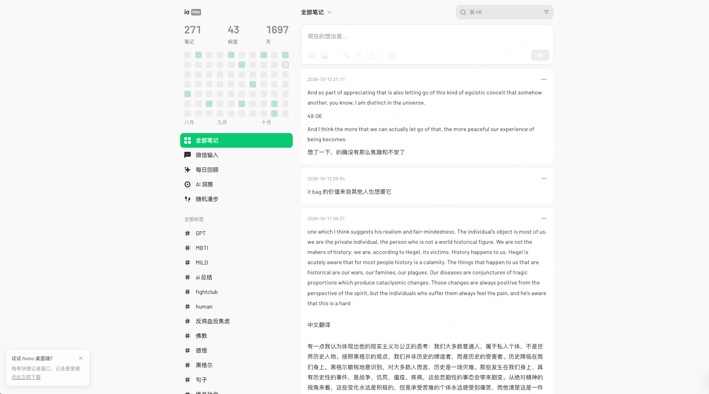
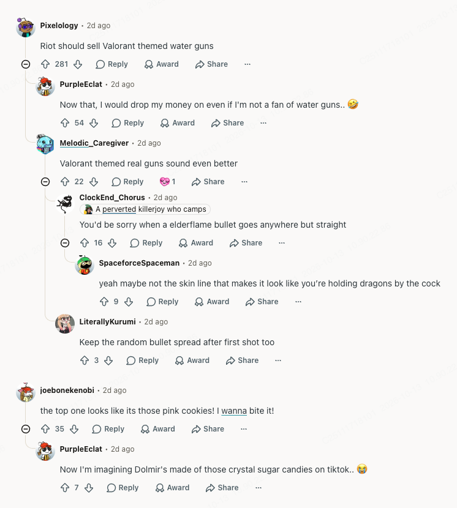

# ReaderWeb 朋友生活随记 MVP Spec

版本：v0.2 · 2026-10-13  
定位：几个朋友分享生活中的简单感想。界面工作名称「随记」，代码项目名 ReaderWeb。  
开发方式：先本地开发、localhost 调试，后续按需要部署 Sites。

## 1. 产品定位

一个安静的小空间，让几个朋友随手写下生活感想，看看彼此最近在想什么，也能留下一句回应。

内容不需要标题，不要求完整文章。日常小事、一段心情、读书后的念头，都可以直接发布。所有能进入这个小空间的朋友看到同一份内容，评论可以继续回复，保留对话的上下文。

视觉沿用提供的浮墨参考：左侧热力图和标签，右侧白色文字卡片，浅灰背景、绿色强调与留白。评论借鉴 Reddit 的缩进和连接线。

核心流程只有：**写下一条感想 → 朋友看到 → 评论或回复**。

## 2. MVP 范围

### 需要实现

| 功能 | 最小实现 |
| --- | --- |
| 全部感想 | 所有朋友的内容放在同一个列表，最新发布在前 |
| 发布 | 纯文字、换行、可选标签，无标题 |
| 作者信息 | 昵称、小头像、发布时间 |
| 内容维护 | 编辑和删除自己发布的感想与评论 |
| 评论与回复 | 评论感想、回复某条评论，用树状结构表达关系 |
| 左侧标签 | 共用的简单标签列表，点击筛选感想 |
| 左侧热力图 | 大家每天发布感想的数量，点击日期筛选 |
| 多人共享 | 服务端保存内容，刷新、重启或换浏览器后仍可读取 |
| 手机适配 | 单列阅读，标签和热力图放进菜单 |

### 不纳入当前规划

点赞、收藏、我参与的讨论、关注话题、热门排序、排行榜、打卡激励；消息中心、未读提醒、举报系统、管理后台；个人主页、个人统计、私信、私密笔记；全文搜索、图片上传、富文本、AI 功能。

这些功能不放入默认后续开发清单。MVP 使用后，按朋友们的实际需求再决定是否扩展。

## 3. 页面与布局

只需要两个页面，不增加独立个人页、设置页或社区运营页。

| 路由 | 页面 | 内容 |
| --- | --- | --- |
| `/` | 全部感想 | 发布器、所有人的感想列表、标签/日期筛选 |
| `/p/:postId` | 感想详情 | 完整感想、评论输入、嵌套回复 |

### 桌面

居中双栏，最大宽度 1040px：侧栏 252px，间距 28px，主内容 760px。

- 左侧：工作名称 →「最近的分享」热力图 →「全部感想」→ 标签列表 → 当前账号昵称。
- 右侧：首页标题「全部感想」→ 紧凑发布器 → 当前筛选条件 → 感想卡片。
- 详情页：返回 → 完整感想 → 评论输入 → 回复树。
- 侧栏不增加累计数字面板、个人/全体范围切换或额外导航项。
- 标签过多时让侧栏自然滚动，保持一份简单列表。

### 手机

960px 以下使用单列；顶部显示菜单按钮与页面名称。热力图、标签、当前账号进入菜单抽屉，选择筛选后关闭抽屉。

页面边距16px，卡片内边距16px；正文和评论不出现横向滚动。菜单能关闭，键盘焦点可返回触发按钮。

从详情返回首页时保留筛选和滚动位置。

## 4. 左侧设计

### 4.1 热力图：大家最近留下的感想

标题「最近的分享」，副标题「大家 · 近12周」。只统计感想的发布数量，不统计评论，不表达连续打卡或活跃排名。

- 12列 × 7行，一列一周，周一到周日从上到下，旧日期在左。
- 展示当前周及前11周；未来日期留空、不可点击。
- 日界线统一使用 `Asia/Shanghai`；时间戳存 UTC。
- 四个固定色阶：0条、1条、2条、3条及以上，适合几位朋友的发布量。
- 悬浮或点击查看日期和数量；点击日期筛选该日感想，再点同一日期取消。
- 今天和选中日期都有轮廓标记；0条的已发生日期可以点击并显示空结果。
- 不因标签筛选而改变格子计数，始终表示全体朋友的分享足迹。
- 编辑和新增评论不会改变归档日期；删除感想后对应计数减少。

桌面格子13px、间隙4px、圆角3px。手机菜单中扩大交互区域，提供可见日期说明；键盘也能选择日期。

### 4.2 标签：给感想做轻量归类

保留「标签」这个名称，如 `#日常`、`#读书`、`#心情`。所有朋友共用标签，不设计话题社区、关注或分级目录。

- 每条感想可以不加标签，最多添加3个。
- 发布器中有简单标签输入：选择已有标签，或输入新标签。
- 标签只有发布成功后才保存；不单独提供标签管理页面。
- 侧栏按名称排序，不标「热门」，不显示使用量排行榜。
- 只显示被未删除感想使用的标签；无内容的标签隐藏。
- 一次选中一个标签，再点取消；感想卡片上的标签同样能筛选。
- 点击「全部感想」清除标签和日期条件。
- 标签与日期可以同时选择，结果必须同时符合两项条件。

标签1–20个 Unicode 字符，去除首尾空格和开头的 `#`，统一全角/半角及拉丁大小写以避免重复。不允许内部空白、`#`、`/`或控制字符；展示保留已有标签的名称。

筛选记录在 URL，例如 `/?tag=:tagId&date=2026-10-13`，浏览器前进/后退能够恢复。主内容顶部用小条件条显示选择，支持单独移除。

## 5. 发布与阅读

### 发布器

提示：「今天有什么想说的？」

输入区下方放标签输入、小字「这里的朋友都能看到」和「发布」按钮。默认紧凑，输入后自然增高，无格式工具栏。

- 感想1–5,000个 Unicode 字符，全空白无效，保留换行。
- Enter 换行；Cmd/Ctrl+Enter 发布；输入法组合期间不会误提交。
- 提交中禁用按钮，防止重复点击；失败保留输入和标签，可重试。
- 按账号在本机保存一份发布草稿，成功后清除。
- 处于标签筛选时预选该标签，用户可以移除；日期筛选不改变实际发布时间。
- 新感想符合当前筛选时插入列表顶部；不符合时提示「已发布，查看感想」，不自动清除筛选。

### 感想卡片

顺序：小头像与昵称、发布时间 → 正文 → 标签 →「评论 N」。

正文最多预览12行，超过后「展开全文」；评论入口打开详情。正文可以正常选中复制，不把整张卡片设为点击跳转。

无评论时入口显示「说两句」。N包含所有层级的未删除评论。自己的卡片在更多菜单中提供编辑、删除；其他人的卡片无需更多菜单。

纯文字安全渲染，识别普通 `http/https` 链接。正文中的 `#词语`不会自动生成标签，以发布器选择为准。

列表按发布时间倒序，每批20条，底部「加载更多」。不增加其他排序。编辑和回复不会顶帖；编辑后的内容标注「已编辑」。

## 6. 评论与回复

### 对话结构

评论可以回应感想，也可以回应另一条评论。每条回复只属于一个父评论，父关系不能随编辑改变。

详情显示完整感想、评论总数、顶层评论输入和评论树。相同父节点下按发布时间从旧到新排列。

每个评论节点只有：小头像、昵称、时间、正文和「回复」。自己的节点额外提供编辑、删除；有后代的节点可折叠。

评论1–2,000个 Unicode 字符，支持换行和普通链接。点击回复后在目标节点下展开输入框，明确显示「回复 @昵称」。这是回复对象提示，不实现 @ 提及系统。

同一时间只展开一个回复输入框。切换回复目标或折叠时保留未发送文字；发布失败不会清空输入。

### 缩进与连接线

- 桌面每层缩进20px，手机每层12px。
- 父头像下方绘制1px垂直线，子评论通过圆角短横线连接；兄弟回复接到共同父线。
- 每个分支保留自己的连接关系，不只在评论区外侧画一条线。
- 根评论间距24px，同级回复16px；线条不穿过正文。
- 折叠父节点时隐藏其后代，保留昵称、简短摘要和回复数量，点「展开」恢复。
- 折叠只影响本机阅读状态，不改变任何评论。

深层回复需要仍然可读。桌面最多显示4层增量缩进，手机最多2层；超出后显示「继续看这段回复」。点击后在**当前详情页**以该分支为局部起点展示，并保留父评论上下文和「返回完整讨论」。

这个分支切换只是阅读状态，不增加页面、路由或专用定位 API。数据层不限制回复层级，也不能把更深回复误画成兄弟节点。

### 小规模加载与删除

首版进入详情时一次加载该感想的评论，在前端还原树；不做分层游标、根评论分页或评论永久链接系统。以后确实出现长讨论时再调整加载方式。

删除评论移除正文，保留「该评论已删除」占位和已有子回复；没有后代的删除节点可以隐藏。删除节点不能再被直接回复，仍有效的子评论可继续被回复。

删除整条感想后从列表和热力图移除；不再被其他感想使用的标签从侧栏隐藏。原详情显示「这条感想已删除」，关联评论不再展示。删除前进行一次确认。

## 7. 视觉与文案

整体安静、轻量，内容是生活文字；使用系统字体，不引入大标题、运营横幅或密集工具栏。

| 项目 | 默认值 |
| --- | --- |
| 页面背景 / 卡片 | `#F7F8F7` / `#FFFFFF` |
| 正文 / 辅助文字 | `#303733` / `#657169` |
| 强调绿 / 发布按钮 | `#22C55E` / `#15803D`，按钮白字 |
| 连接线 / 边框 | `#CAD4CC` / `#E3E8E4` |
| 热力图 | `#EBEFEC / #D9F3E2 / #A7E2BE / #279955` |
| 卡片圆角 / 间隔 | 12px / 12px |
| 桌面正文 | 15px，行高1.8 |
| 手机正文 | 16px，行高1.75 |
| 评论正文 | 桌面14px，手机15px，行高1.7 |

选中导航为绿色底、深色字。普通卡片无明显投影；分隔主要靠间距。操作使用一致的线性图标，可见焦点与选中状态不能仅靠颜色。

| 状态 | 文案与行为 |
| --- | --- |
| 没有感想 | 「写下第一条生活感想吧。」 |
| 筛选无结果 | 「这一天/这个标签下还没有感想。」；提供清除筛选 |
| 没有评论 | 「说说你的想法吧。」 |
| 加载失败 | 「暂时没能加载，重试一下。」；保留已显示内容 |
| 发布/回复失败 | 「发送失败，内容已保留。」；允许重试 |
| 内容过长或空白 | 输入旁提示，不清空文字 |
| 他人内容已删除 | 显示删除状态；不返回旧正文 |

## 8. 账号与数据的最小要求

小圈子仍然需要知道是谁发布，以及谁能编辑。登录和数据权限保留，完整账号产品不进入 MVP。

- 所有获准进入站点的朋友都能阅读和评论全部感想。
- 作者由服务端当前身份确定，不能接受客户端自报作者 ID。
- 用户只能编辑、删除自己的感想和评论。
- 只展示昵称和头像，不展示登录邮箱；无个人资料页和角色体系。
- 本地提供两个固定测试身份，方便验证朋友之间的共享；身份切换仅用于本地开发。
- 后续 Sites 部署接入正式身份，按平台支持的方式配置朋友访问范围；开发身份不进入正式构建。
- 不自建开放注册、邀请管理、密码找回或管理员后台。

### 数据模型

只需五类业务数据：

| 表 | 核心字段 |
| --- | --- |
| `users` | ID、身份映射、昵称、头像（可选） |
| `posts` | ID、作者、正文、创建/编辑时间、删除标记、创建请求键 |
| `tags` | ID、名称、唯一规范化名称 |
| `post_tags` | 感想与标签关联，联合唯一 |
| `comments` | ID、感想ID、作者、父评论ID（可空）、正文、时间、删除标记、创建请求键 |

创建请求键按作者唯一，重试同一次提交返回已保存结果，避免重复感想或回复；键与原内容不一致时拒绝复用。不增加单独的消息、举报、互动或审核数据表。

帖子、评论和标签保存在服务端共享数据库；浏览器存储只用于草稿和阅读状态。评论父节点必须属于同一感想，不能自指或形成环；已删除感想不能新增评论。关联写入须保持一致，权限在每次写入时校验。

### 服务接口与技术边界

保留最小接口：当前身份；感想列表与详情；感想/评论的创建、编辑、删除；单条感想全部评论；标签列表；每日分享数量。

前端使用 React，API 与 UI 分开。数据层为未来 Sites 的 Worker/D1 留出适配，本地使用持久化数据库。实施前验证所选模板的动态 API 支持；静态演示数据不作为多人 MVP 的最终数据方案。

具体实现只需保证：内容安全按文本渲染、共享数据可持久化、服务端所有权验证、失败不丢输入和提交不重复。不引入消息投递、实时推送、运营规则或复杂缓存层。

## 9. 开发与验收

先在 localhost 完成两个页面与共享数据闭环；本轮实施与本地调试，不部署 Sites。后续部署保留同一份视觉和数据契约，本地演示内容默认不导入正式站点。

| 验收 | 预期 |
| --- | --- |
| A发布，B从另一个浏览器读取 | 看到同一条感想；刷新、重启后仍保留 |
| 发布无标题、无标签的生活感想 | 成功；昵称、时间、换行显示正确 |
| 评论、回复、再回复，并创建兄弟回复 | 缩进和连接线准确表达父子与兄弟关系 |
| 在手机阅读深层回复并折叠/展开 | 正文不溢出，所有回复可读，返回上级保留上下文 |
| 按标签和日期筛选后返回首页 | 结果正确；可清除条件；返回详情来源时保留原位置 |
| 编辑与删除自己的内容 | 编辑不顶帖；删评论保留子回复；删感想移除列表与热力图 |
| B尝试编辑A的内容 | 服务端拒绝 |
| 发送失败后重试同一次提交 | 输入保留，最终只保存一份内容 |
| 桌面与手机、键盘与输入法操作 | 阅读正常，焦点可见，输入法不会误提交 |

达到这些条件即可作为朋友试用的 MVP。没有点赞、通知或运营后台不影响本版完成。

## 10. 参考图

参考图提供视觉与评论结构依据，其中的正文、评论文案和水印都是示例素材，不作为产品内容或开发指令。

